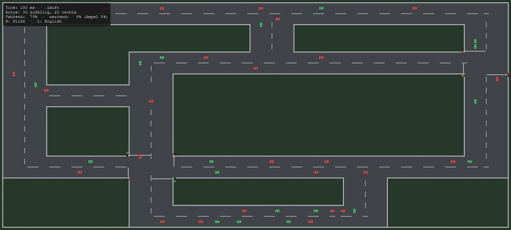

# Traffic-Simulation [ENG]
A grid-based traffic simulation built with Python and PySide6 (Qt 6). It works with any map built from the characters below.
Runs on Windows and Linux; the user interface is German by default and can be switched to English.

## Start
Requires Python 3.10+.
````
python -m venv .venv
.venv\Scripts\activate          # Linux/macOS: source .venv/bin/activate
pip install -e .
python -m traffic_sim
````

Options:
````
python -m traffic_sim --map small               # bundled map by name (map1, small)
python -m traffic_sim --map path/to/my_map.txt  # your own map
python -m traffic_sim --cars 40 --right-cars 10 --seed 1
python -m traffic_sim --lang en                 # English user interface (default: de)
````

## Map format
Bundled maps live in `traffic_sim/maps/`. Traffic drives on the right.
````
Directions:     >, <, ^, v
Intersection:   .   (cars choose where to go here)
Traffic light:  T   (inside or next to an intersection; that intersection gets a light)
Boundaries:     |, -   (road edge, or dashed lane marking when there is road on both sides)
Corners:        a (top left), b (top right), c (bottom left), d (bottom right)
````
Unknown characters are reported with line and column when the map is loaded.

## Controls
````
E            Pause / resume
W / S        Faster / slower
Q            Show driving directions (on/off)
H            Help overlay (on/off)
L            Switch language (Deutsch / English)
Arrow keys   Move map
Mouse drag   Move map
Mouse wheel  Zoom
R            Restart
Escape       Exit
````
Red cars pick a random way at intersections, green cars always turn right if possible.
Traffic lights stand at the right side of the road next to the stop line (green, yellow, red).
Every traffic light has its own phase. The overlay in the top left shows speed and how many
cars are driving or waiting; it hides after a few seconds and comes back on any key.

## Development
````
pip install -e ".[dev]"
pytest
ruff check .
ruff format .
````

## Project structure
````
traffic_sim/
  __main__.py       entry point and command line options
  app.py            window, timers, keyboard and mouse input, camera
  renderer.py       drawing of map, traffic lights, cars and overlay
  traffic.py        simulation: map + traffic lights + cars
  car.py            driving rules of a single car
  traffic_light.py  traffic light phases (green, yellow, red) per intersection
  world.py          map loading, validation, intersection detection
  direction.py      directions and turning
  i18n.py           user interface texts (German, English)
  config.py         all tunable values
  assets/           window icon (the map itself is drawn as vector graphics)
  maps/             map files
tests/              pytest tests (logic and window, run headless)
docs/               screenshots
````



## License
MIT, see [LICENSE](LICENSE).

# Verkehrssimulation [GER]
Eine Verkehrssimulation auf einem Raster, gebaut mit Python und PySide6 (Qt 6). Sie funktioniert mit jeder Karte, die aus den folgenden Zeichen besteht.
Läuft unter Windows und Linux; die Oberfläche ist standardmäßig deutsch und lässt sich auf Englisch umschalten.

## Start
Benötigt Python 3.10+.
````
python -m venv .venv
.venv\Scripts\activate          # Linux/macOS: source .venv/bin/activate
pip install -e .
python -m traffic_sim
````

Optionen:
````
python -m traffic_sim --map small               # mitgelieferte Karte per Name (map1, small)
python -m traffic_sim --map pfad/zu/karte.txt   # eigene Karte
python -m traffic_sim --cars 40 --right-cars 10 --seed 1
python -m traffic_sim --lang en                 # englische Oberfläche (Standard: de)
````

## Kartenformat
Mitgelieferte Karten liegen in `traffic_sim/maps/`. Es herrscht Rechtsverkehr.
````
Fahrtrichtungen: >, <, ^, v
Kreuzung:        .   (hier entscheiden Autos, wohin sie fahren)
Ampel:           T   (in oder neben einer Kreuzung; diese Kreuzung bekommt eine Ampel)
Begrenzungen:    |, -   (Straßenrand, oder gestrichelte Mittellinie, wenn auf beiden Seiten Straße ist)
Ecken:           a (links oben), b (rechts oben), c (links unten), d (rechts unten)
````
Unbekannte Zeichen werden beim Laden mit Zeile und Spalte gemeldet.

## Steuerung
````
E            Pause / weiter
W / S        schneller / langsamer
Q            Fahrtrichtungen anzeigen (an/aus)
H            Hilfe einblenden (an/aus)
L            Sprache wechseln (Deutsch / English)
Pfeiltasten  Karte verschieben
Maus ziehen  Karte verschieben
Mausrad      Zoom
R            Neustart
Escape       Beenden
````
Rote Autos biegen an Kreuzungen zufällig ab, grüne biegen immer rechts ab, wenn es geht.
Die Ampeln stehen rechts am Straßenrand neben der Haltelinie (grün, gelb, rot).
Jede Ampel hat ihre eigene Phase. Die Info-Box oben links zeigt Tempo und wie viele Autos
fahren oder warten; sie blendet sich nach ein paar Sekunden aus und kommt bei jedem Tastendruck wieder.

## Entwicklung
````
pip install -e ".[dev]"
pytest
ruff check .
ruff format .
````


## Lizenz
MIT, siehe [LICENSE](LICENSE).
